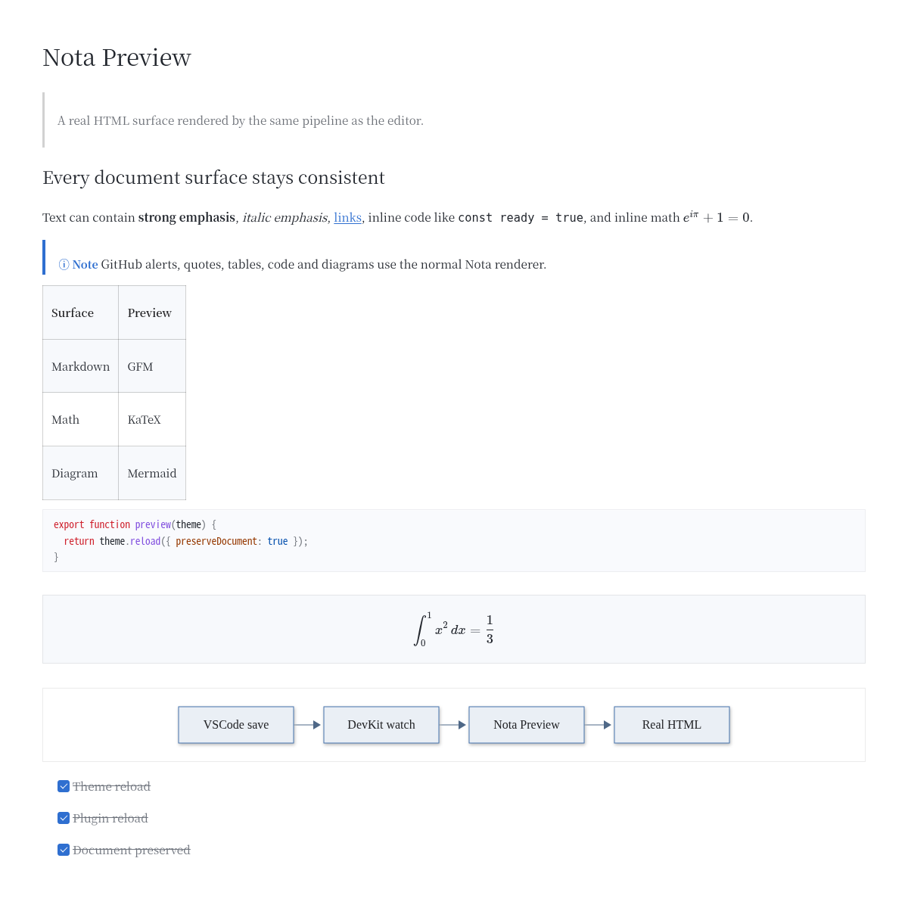
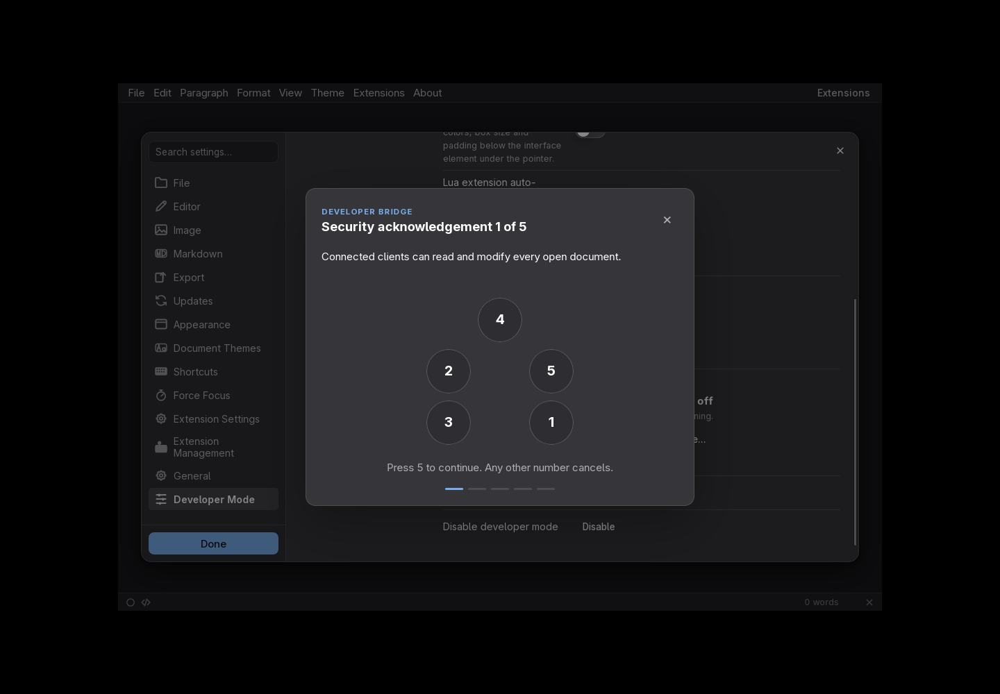
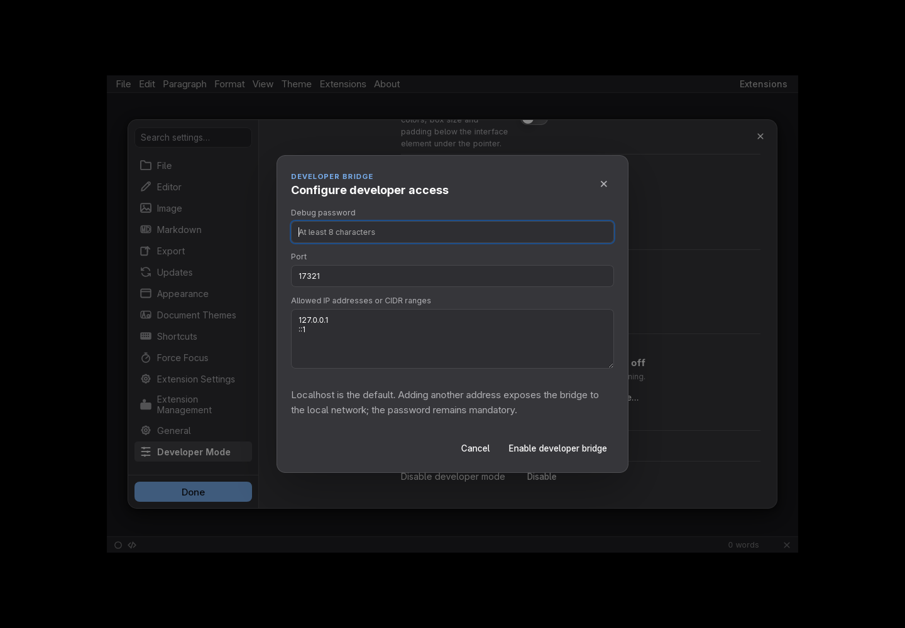
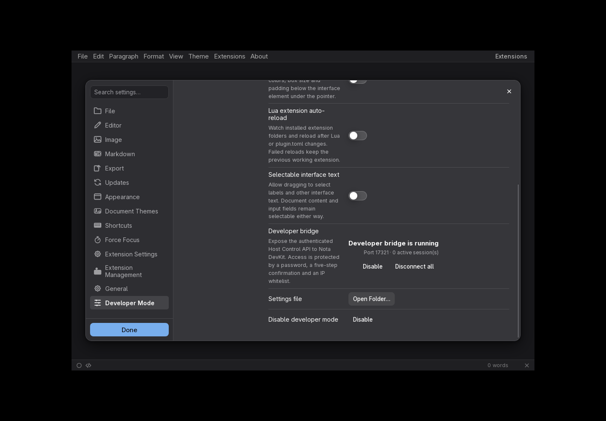

# Nota DevKit

Nota DevKit 是连接真实 Nota 实例的本地开发工具，不包含第二套 Markdown 渲染器或 Lua 运行时。主题、公式、代码块、Mermaid、HTML 块和扩展仍由 Nota 自己处理。

典型工作流：

```text
左侧编辑器保存文件
        ↓
nota-devkit 监听变化
        ↓
真实 Nota 重载主题、扩展或重新导出预览
        ↓
右侧无工具栏预览窗口刷新
```



开发者桥接的五步确认、凭据表单和运行状态均来自真实 Nota 窗口：







## 环境

- Node.js 22 或更新版本
- 已开启开发者模式的 Nota
- Nota 中已启用开发者桥接

DevKit 当前没有第三方运行时依赖，也没有构建步骤。

## 启用宿主控制

1. 在 Nota 的“关于”中连续点击版本号五次，开启开发者模式。
2. 打开“设置 → 开发者模式 → 开发者桥接”。
3. 完成五步随机数字确认。
4. 设置至少 8 个字符的调试密码。密码以 Argon2 哈希保存在 Nota 配置目录。
5. 默认只允许 `127.0.0.1` 和 `::1`。除非确实需要其他设备访问，否则不要扩大白名单。

桥接默认关闭，且只有开发者模式开启时才能启动。关闭开发者模式会同时停止桥接并清除现有会话。

## 使用

```bash
node ./bin/nota-devkit.mjs doctor --password 'your debug password'
node ./bin/nota-devkit.mjs check ./theme ./plugin
node ./bin/nota-devkit.mjs watch ./theme ./plugin --password 'your debug password'
```

安装为本地命令：

```bash
npm link
nota-devkit doctor --password 'your debug password'
```

推荐通过环境变量提供密码，避免凭据进入项目文件：

```bash
export NOTA_DEVKIT_PASSWORD='your debug password'
nota-devkit doctor
```

非敏感的项目设置可以写入项目根目录的 `.nota-devkit.json`：

```json
{
  "nota": {
    "host": "127.0.0.1",
    "port": 17321,
    "token": "",
    "password": "",
    "timeoutMs": 30000
  },
  "watch": {
    "debounceMs": 120,
    "paths": ["./themes/my-theme", "./plugins/my-plugin"],
    "ignore": [".git", "node_modules", "dist", "target", ".nota-devkit"]
  },
  "preview": {
    "port": 17322,
    "windowWidth": 1100,
    "windowHeight": 920,
    "open": true,
    "entry": null,
    "theme": null,
    "title": null
  }
}
```

命令行参数覆盖配置文件：

```bash
nota-devkit watch . --port 17321 --password 'your debug password'
nota-devkit doctor --host 127.0.0.1
```

## 模拟输入

DevKit 可以向已认证的真实 Nota 编辑区重放输入脚本，适合演示编辑过程和无障碍录制：

```bash
nota-devkit input ./examples/promo-input.json
```

脚本支持 `text`、`key`、`shortcut`、`wait`、`focus`、`click` 和
`command`。文本默认按字素逐个输入，`interval` 控制间隔。示例：

```json
{
  "actions": [
    { "type": "focus" },
    { "type": "text", "text": "# Nota", "interval": 80 },
    { "type": "key", "key": "Enter" },
    { "type": "text", "text": "Local-first writing.", "interval": 35 },
    { "type": "shortcut", "keys": "Ctrl+B" },
    { "type": "wait", "ms": 600 }
  ]
}
```

DevKit 不负责抓帧或生成视频。宣传视频应使用系统录屏工具录制真实 Nota
窗口，同时运行上述输入脚本。

当前会话令牌只保存在 DevKit 进程内存中。重新启动 DevKit 后会用密码重新认证。

## 预览

预览窗口只显示文档，不包含菜单、工具栏、侧栏、状态栏或设置。Chrome/Edge 的 App 模式用于获得独立窗口。

```bash
nota-devkit preview ./note.md --theme ./theme.css --password 'your debug password'
nota-devkit preview ./export.html --theme ./theme.css
```

- Markdown 由运行中的 Nota 通过真实导出管线渲染。保存 Markdown 或主题 CSS 后，预览自动刷新。
- HTML 文件由内置只读服务器提供，主题 CSS 在返回页面前注入。
- 窗口标题优先显示当前 CSS 文件名；没有 CSS 时显示 HTML 或 Markdown 文件名。
- `--no-open` 只启动本地服务器，适合截图和自动化。

## 命令

### `status` / `documents`

查看当前活动文档和所有已打开文档：

```bash
nota-devkit status --password 'your debug password'
nota-devkit documents --password 'your debug password' --json
```

状态包含文档 id、标题、路径、活动状态、未保存状态和 revision。路径只显示，
不会读取或打印正文。

### `read`

读取当前活动文档，或按 id 读取指定文档：

```bash
nota-devkit read --password 'your debug password'
nota-devkit read 12 --password 'your debug password'
nota-devkit read active --password 'your debug password' --json
```

默认输出纯 Markdown；`--json` 同时包含 id、标题、路径、dirty 和 revision。
读取的是 Nota 编辑器的实时内容，包括尚未保存的修改。

### `write`

整篇替换当前活动文档或指定文档：

```bash
nota-devkit write active --text '# Changed remotely' \
  --password 'your debug password'

nota-devkit write 12 --file ./replacement.md \
  --password 'your debug password'
```

修改走 Nota 编辑器事件，用户在窗口中立即可见，并可用 `Ctrl+Z` 撤销。

### `open`

请求远程 Nota 打开文件。路径是 **Nota 主机上的绝对路径**：

```bash
nota-devkit open /home/user/notes/today.md \
  --host 192.168.1.23 --password 'your debug password'
```

远程控制示例：

```bash
export NOTA_DEVKIT_PASSWORD='your debug password'

nota-devkit status --host 192.168.1.23
nota-devkit read active --host 192.168.1.23
nota-devkit write active --text 'remote update' --host 192.168.1.23
nota-devkit open /home/user/notes/next.md --host 192.168.1.23
```

### `watch`

监听目录或文件：

- CSS、字体、图片和主题清单：重载主题。
- Lua 与 `plugin.toml`：事务式重载扩展；失败时保留旧实例。
- Nota 暂时不可达时保留最新待处理事件，并自动重试。

### `check`

校验主题和扩展源码：

- CSS 花括号、非法 URL 协议和本地资源引用。
- `plugin.toml` 必填字段、API 版本和能力。
- Lua 本地 `require` 文件。
- 设置声明和开发服务器声明所需能力。

### `doctor`

检查桥接协议、认证与 `app.info`。`doctor` 成功只表示协议链路可用，不代替实际扩展功能测试。

### `info`

显示 Nota 版本、打开文档数量、插件 API 版本与诊断摘要。

### `logs`

读取开发者模式下持久调试日志的增量：

```bash
nota-devkit logs
nota-devkit logs 4096 --json
```

### `capture`

通过宿主控制接口截取匹配标题的窗口：

```bash
nota-devkit capture ./window.png --title "theme.css — Nota Preview"
```

窗口枚举由系统桌面提供。没有窗口管理器的最小 Xvfb 环境会返回
`_NET_CLIENT_LIST_STACKING not supported`，不能替代真实桌面验收。

### `inspect`

读取并校验一个扩展目录：

```bash
nota-devkit inspect ./plugin
```

### `rpc`

直接调用 Host Control 方法，参数必须是 JSON 对象：

```bash
nota-devkit rpc app.info
nota-devkit rpc logs.read '{"offset":0}'
```

## 安全边界

- 桥接默认关闭，并要求开发者模式、密码和 IP/CIDR 白名单。
- 只有密码认证后才能调用宿主方法。
- 同一 IP 一分钟内连续认证失败 8 次后暂时拒绝认证。
- 会话默认 12 小时后过期，可从设置页一次断开全部会话。
- 非回环白名单会扩大暴露面。当前传输为局域网明文 HTTP，不应在不可信网络上启用。
- DevKit 的连接凭据不得写入日志、截图或公开仓库。

协议细节见 [docs/PROTOCOL.md](docs/PROTOCOL.md)，架构与取舍见 [docs/DESIGN.md](docs/DESIGN.md)。
自动与真实窗口验证记录见 [docs/VERIFICATION.md](docs/VERIFICATION.md)。
